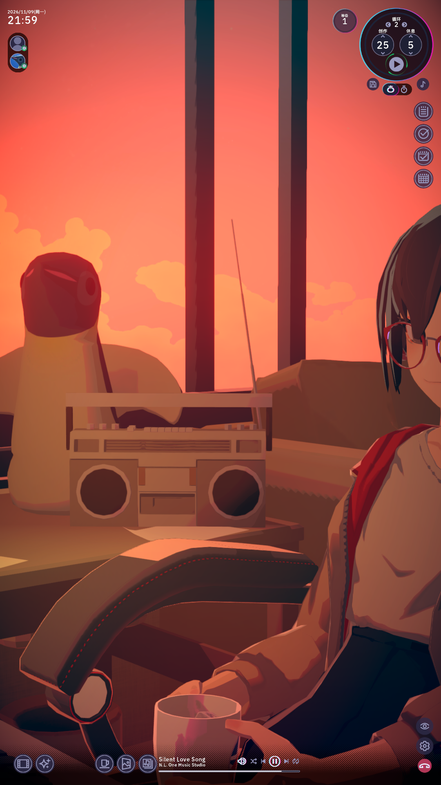
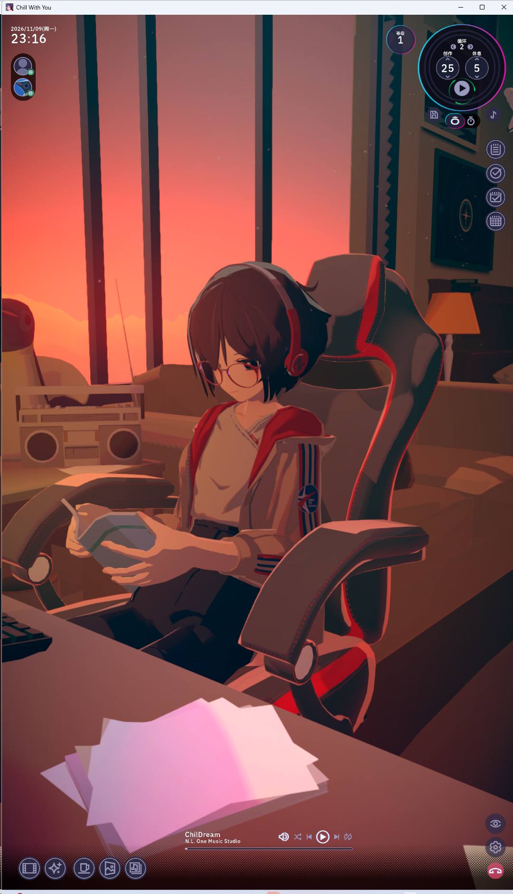

# Chill Portrait

**把 Satone 放到右侧竖屏。** Chill Portrait 是《Chill with You : Lo-Fi Story》Windows Steam 版的非官方模组。它重新安排日常房间的竖屏构图和界面，也能把游戏作为可穿透的背景留在副屏。

- **竖屏构图**：把 Satone 移回画面中央，调整番茄钟、侧栏和底部播放器。
- **镜头远近**：在竖屏日常房间，按住 **Ctrl** 向上滚动拉近，向下滚动拉远。调整会自动保存。
- **背景模式**：按 **Ctrl+Alt+F10** 将游戏无边框铺满目标屏幕。普通应用可以盖在上面，鼠标可以穿透，动画和音乐在失焦时继续。
- **托盘控制**：右键通知区域里的 Chill Portrait 图标，可以恢复交互、切换模式或打开原版「结束通话」确认框。

## 竖屏效果对比 / Portrait comparison

| 原版竖屏 / Before | 启用 Chill Portrait / After |
| :---: | :---: |
|  |  |

## 安装

1. 在 [GitHub Releases](https://github.com/ufoooo2025/ChillPortrait/releases/latest) 下载带有 Windows 安装器的 ZIP，并完整解压。
2. 通过「结束通话」关闭游戏。双击 **Install.cmd**。安装器会查找 Steam 游戏库，找不到时会让你选择包含 Chill With You.exe 的文件夹。
3. 安装完成后，从 Steam 启动游戏。游戏默认以可操作的交互模式运行。

安装器会沿用可用的 BepInEx 5。首次安装时，它会从 [BepInEx 官方发布页](https://github.com/BepInEx/BepInEx/releases/tag/v5.4.23.5) 下载 5.4.23.5 x64 并校验 SHA-256。安装过程无需管理员权限，Steam 库需允许当前用户写入。升级时重新运行同一安装器即可。

卸载时先退出游戏，再双击 **Uninstall.cmd**。卸载只移除模组文件，保留 BepInEx 和设置。如果安装器修改了已有的 BepInEx.cfg，原件会保存为 BepInEx.cfg.before-ChillPortrait。

## 设置与兼容性

- 模组默认选择主屏右侧最靠右的竖屏。可在游戏目录的 BepInEx/config/local.chillportrait.cfg 中设置 Monitor（例如 \\.\DISPLAY2），也可修改 Shortcut 和 StartOnRight。ZoomOffset 改回 0 后重新启动，即可恢复默认镜头距离。
- 已实测 Windows 11 25H2、Steam Build 26291741。其他游戏版本尚未验证。
- 背景模式使用 Windows 普通窗口层级。Win+D 会按普通应用窗口处理游戏。横屏和剧情镜头沿用游戏原本的构图。

## English

Chill Portrait is an unofficial Windows Steam mod for **Chill with You : Lo-Fi Story**. It centers Satone in portrait windows, rearranges the HUD, and adds persistent camera zoom with **Ctrl + mouse wheel**. **Ctrl+Alt+F10** switches between the interactive window and a click-through background that stays below other apps. The Windows tray menu can restore the window or open the game's regular End Call confirmation.

Download and extract the Windows ZIP from [Releases](https://github.com/ufoooo2025/ChillPortrait/releases/latest). Close the game, run **Install.cmd**, then start it from Steam. Run **Uninstall.cmd** to remove the mod. Tested on Windows 11 25H2 with Steam build 26291741.

## 从源码构建 / Build from source

将 BepInEx 5.4.23.5 x64 解压到仓库的 loader 目录。安装 .NET SDK 后运行 Build.ps1 -Game "游戏安装目录"。脚本使用本地游戏程序集构建 dist/ChillPortrait.dll。源码仓库和发布包不包含游戏文件。
